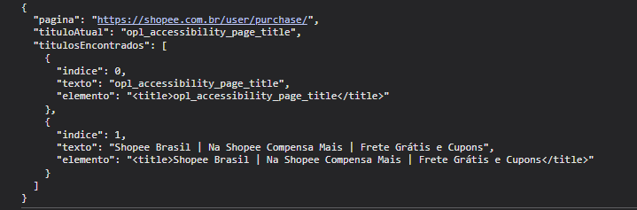

# Estudo de Caso 001: Shopee Brasil

**Categoria:** Investigação de interface web / HTML  
**Data:** 27/11/2026  
**Status:** Reportado à empresa

## 1. Descrição do problema

Ao acessar a página "Minhas Compras" na versão web da Shopee Brasil, foi identificado que o título exibido na aba do navegador era:

`opl_accessibility_page_title`

O texto aparenta ser uma chave interna de tradução que não foi substituída pelo conteúdo esperado.

## 2. Ambiente de investigação

- Plataforma: Shopee Brasil
- Ambiente: Navegador Google Chrome
- Ferramenta: Chrome DevTools
- Recursos utilizados: Elements e Console

## 3. Investigação técnica

Durante a inspeção do documento HTML, foram encontrados dois elementos `<title>` dentro do elemento `<head>`:

**Primeiro elemento:**

```html
<title>opl_accessibility_page_title</title>
```

**Segundo elemento:**

```html
<title>Shopee Brasil | Na Shopee Compensa Mais | Frete Grátis e Cupons</title>
```

Ambos os elementos estavam conectados ao documento (`isConnected: true`).

Ao executar:

```javascript
document.title
```

O navegador retornou:

```text
opl_accessibility_page_title
```

Também foi utilizada a seguinte verificação:

```javascript
document.head.innerHTML.includes('opl_accessibility_page_title')
```

**Resultado:** `true`.

## 4. Resultado observado

Ao consultar a propriedade `document.title`, foi retornado o texto `opl_accessibility_page_title`.

A inspeção do `<head>` mostrou dois elementos `<title>` conectados ao documento. O primeiro continha a chave `opl_accessibility_page_title`, enquanto o segundo continha o título institucional da Shopee Brasil.

Assim, foi constatada uma divergência entre os dois elementos e o título retornado por `document.title`.

## 5. Resultado esperado

A página deveria apresentar um único título de documento, legível e apropriado ao conteúdo, sem expor chaves internas de tradução ou internacionalização.

## 6. Análise técnica

A presença de dois elementos `<title>` no mesmo documento indica uma inconsistência na estrutura HTML observada.

O texto `opl_accessibility_page_title` apresenta características de uma chave interna de tradução ou internacionalização (i18n), mas essa interpretação não foi confirmada.

Uma possível hipótese é uma falha na geração ou atualização dos metadados da página.

A origem técnica do comportamento não foi identificada durante esta investigação.

## 7. Comunicação

O problema foi documentado e encaminhado ao atendimento da Shopee por meio dos canais de suporte disponíveis, para avaliação e eventual encaminhamento à equipe técnica responsável.

## 8. Conclusão

A investigação demonstrou como ferramentas de desenvolvimento do navegador podem ser utilizadas para identificar inconsistências em aplicações web, inspecionar elementos HTML e documentar possíveis falhas técnicas.

O caso também permitiu observar uma divergência entre os elementos `<title>` presentes no documento e o valor retornado por `document.title`, reforçando a importância da inspeção do DOM durante atividades de análise e controle de qualidade.

## 9. Evidências

### Evidência 1: título exibido na aba do navegador


### Evidência 2: inspeção do título no DevTools



### Evidência 3: investigação dos elementos HTML


## 10. Observação posterior

Após uma atualização manual da página (F5), o título voltou a apresentar o texto "Lista de Pedidos".

Esse comportamento indica que a inconsistência observada inicialmente não foi reproduzida após a atualização. A causa e as condições necessárias para reproduzir o problema permanecem desconhecidas.

---

*Estudo independente, realizado para fins educacionais e de desenvolvimento de habilidades em QA.*
