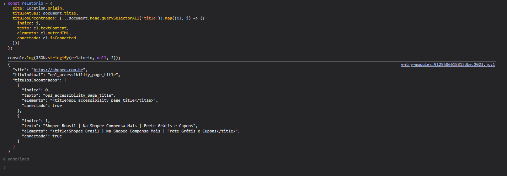

# Estudo de Caso 001: Shopee Brasil

**Categoria:** Investigação de interface web / HTML  
**Data:** 27/11/2026  
**Status:** Reportado à empresa

## 1. Descrição do problema

Ao acessar a página "Minhas Compras" na versão web da Shopee Brasil, foi identificado que o título exibido na aba do navegador era:

`opl_accessibility_page_title`

O texto aparenta ser uma chave interna de tradução que não foi substituída pelo conteúdo esperado.

## 2. Ambiente de investigação

- Plataforma: Shopee Brasil
- Ambiente: Navegador Google Chrome
- Ferramenta: Chrome DevTools
- Recursos utilizados: Elements e Console

## 3. Investigação técnica

Durante a inspeção do documento HTML, foram encontrados dois elementos `<title>` dentro do elemento `<head>`:

**Primeiro elemento:**

```html
<title>opl_accessibility_page_title</title>
```

**Segundo elemento:**

```html
<title>Shopee Brasil | Na Shopee Compensa Mais | Frete Grátis e Cupons</title>
```

Ambos os elementos estavam conectados ao documento (`isConnected: true`).

Ao executar:

```javascript
document.title
```

O navegador retornou:

```text
opl_accessibility_page_title
```

Também foi utilizada a seguinte verificação:

```javascript
document.head.innerHTML.includes('opl_accessibility_page_title')
```

**Resultado:** `true`.

## 4. Resultado observado

O navegador utilizava o primeiro elemento `<title>` como título do documento, exibindo uma chave interna em vez de um título legível.

## 5. Resultado esperado

A página deveria apresentar um título legível e apropriado, sem expor chaves internas de tradução.

## 6. Análise técnica

A presença de dois elementos `<title>` no mesmo documento HTML representa uma inconsistência na estrutura do documento.

Uma possível explicação é um problema na geração dos metadados ou na integração de algum módulo da aplicação.

A origem exata ainda não foi identificada.

## 7. Comunicação

O problema foi documentado e encaminhado ao atendimento da Shopee para análise da equipe técnica responsável.

## 8. Conclusão

A investigação demonstrou como ferramentas de desenvolvimento do navegador podem ser utilizadas para identificar inconsistências em aplicações web, inspecionar elementos HTML e documentar possíveis falhas técnicas.

## 9. Evidências

### Evidência 1: título exibido na aba do navegador


### Evidência 2: inspeção do título no DevTools


### Evidência 3: investigação dos elementos HTML



---

*Estudo independente, realizado para fins educacionais e de desenvolvimento de habilidades em QA.*
